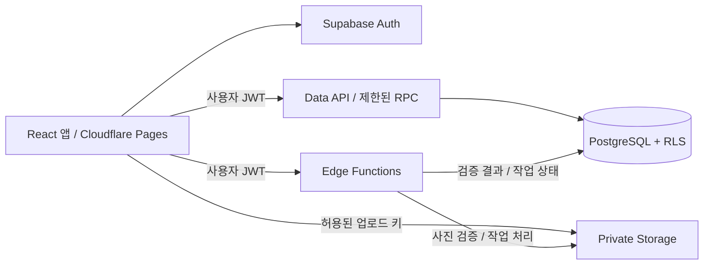

# iLove Pets 서버 설계안 v1

작성일: 2026-10-14 (Asia/Seoul)
상태: 설계 초안 완료. 서버 프로젝트 생성·DB 적용·실제 인증 연결·배포는 아직 수행하지 않았다.
기준: 현재 React/Vite 앱, P0~P3 로컬 MVP, `src/types/domain.ts`, `src/features/local/*`.
진행 기록: [ilove-pets-progress-board.md](./ilove-pets-progress-board.md)

## 1. 목표와 권장 구성

첫 서버 마일스톤의 완료 흐름은 **로그인 → 내 펫 등록 → 사진 게시 → 다른 기기에서 같은 계정으로 조회 → 공개 상세 URL 조회**다. 로컬 모드는 계속 사용할 수 있게 유지하고 서버 모드는 명시적으로 구분한다.

권장안은 Cloudflare Pages + Supabase다. 현재 정적 React 앱을 유지하면서 인증·관계형 DB·사진 저장을 연결할 수 있다. 이것은 이번 설계의 우선안이며 외부 계정 생성이나 유료 플랜 구매를 뜻하지 않는다.

| 계층      | 선택                                          | 역할                                       |
| --------- | --------------------------------------------- | ------------------------------------------ |
| 웹        | 현재 React/TypeScript/Vite + Cloudflare Pages | 화면, 라우팅, 공개 주소                    |
| 인증      | Supabase Auth                                 | 로그인, 세션, 계정 식별                    |
| DB        | Supabase PostgreSQL + RLS                     | 소유권, 게시물·성장 기록, 트랜잭션         |
| 사진      | Supabase Storage의 private bucket             | 업로드·권한 검사·짧은 수명 서명 URL        |
| 서버 작업 | Supabase Edge Functions + DB RPC              | 사진 검증, 삭제 작업, 이전 작업, 계정 삭제 |

브라우저에는 프로젝트 URL과 publishable key만 제공한다. secret/service-role 키는 Edge Functions의 서버 비밀에만 보관한다. `VITE_*` 값은 사용자에게 노출되므로 관리자 키를 넣지 않는다. RLS는 화면의 버튼 숨김과 별도로 DB에서 강제한다. [키 종류](https://supabase.com/docs/guides/getting-started/api-keys), [RLS](https://supabase.com/docs/guides/database/postgres/row-level-security).

## 2. 인증과 앱 모드

- 사용자 선택으로 첫 버전에 Google OAuth와 이메일·비밀번호를 모두 지원한다. DB의 사용자 식별은 제공자별 이메일이나 Google ID가 아니라 Supabase Auth UUID이며, 데이터 모델은 로그인 제공자에 의존하지 않는다. [Google 로그인](https://supabase.com/docs/guides/auth/social-login/auth-google).
- OAuth 공급자 콜백은 Supabase의 콜백 주소를 사용하고, 앱의 복귀 주소는 `/auth/callback`으로 둔다. localhost와 실제 배포 주소를 각각 명시적으로 허용한다. 커스텀 도메인 변경 시 허용 주소도 갱신한다.
- 이메일·비밀번호 흐름은 가입 → 확인 메일 → 로그인, 로그아웃, 비밀번호 재설정 요청 → `/auth/reset-password` 복귀 → 새 비밀번호 저장으로 설계한다. 이메일 확인을 켜고 확인 전에는 인증 전용 쓰기를 허용하지 않는다. 비밀번호는 Auth에만 전달하고 앱 DB·로그·백업에 저장하지 않는다. [이메일 인증 흐름](https://supabase.com/docs/guides/auth/passwords).
- 운영용 SMTP 설정과 가입/복구 메일 템플릿·발신 주소·전달 검증을 S1에 포함한다. Supabase 기본 SMTP를 일반 사용자 대상 운영 메일로 가정하지 않는다. [SMTP 조건](https://supabase.com/docs/guides/auth/auth-smtp).
- Google과 이메일 로그인의 identity 연결은 Auth가 검증한 규칙에 맡기고 앱에서 이메일 문자열만으로 사용자를 합치지 않는다. 동일 이메일의 가입 순서별 자동 연결과 Google 사용자 비밀번호 설정을 S1에서 검증한다. 다른 이메일의 별도 계정은 자동 병합하지 않는다. [계정 연결](https://supabase.com/docs/guides/auth/auth-identity-linking).
- 사용자 ID는 Auth의 UUID로 통일한다. 현재 `CURRENT_USER_ID`, `@mira`, 팔로워 수와 mock 프로필을 인증 사용자로 취급하지 않는다.
- 최초 로그인은 `ensure_profile`을 멱등 실행하여 자신의 profile만 생성한다. username은 서버 생성 기본값으로 시작하고 `update_profile`에서 3~30자의 소문자 영문·숫자·밑줄 및 unique 제약으로 변경한다. 공개 display name/bio와 timezone도 길이·허용 timezone을 서버에서 검증한다.
- 로그인하지 않아도 공개 피드·공개 상세·기존 데모를 볼 수 있다. 댓글·좋아요·클라우드 저장은 인증이 필요하다. 읽기 실패를 정상적인 빈 목록으로 표시하지 않는다.
- 로컬 → 서버 전환은 로그인만으로 자동 업로드하지 않는다. 별도 이전 화면에서 대상 계정과 항목을 확인한다. 로그아웃·계정 전환 시 서버 메모리 캐시와 사진 URL을 해제하고 다른 계정의 데이터를 표시하지 않는다. 로컬 데이터는 명시적 삭제 없이 유지한다.
- Auth 세션 토큰이 localStorage에 보관될 수 있으므로 JSON 백업·사이트 데이터 요약·PWA 캐시에 포함하지 않는다. 앱에서 인증 응답과 개인 API 응답을 캐시하지 않는다.
- 서비스 워커는 `/auth/callback`, `/auth/reset-password`와 인증 code/token/OTP가 있는 탐색 URL을 캐시에서 제외한다. 콜백 처리가 끝나면 URL의 인증 파라미터를 제거한다. 현재 로컬 워커의 탐색 캐시 정책은 S1에서 이 규칙에 맞춰 변경해야 한다.

## 3. 데이터 모델

DB의 기본 키는 UUID다. 프런트의 `pet_*`, `post_*` ID는 어댑터에서 매핑한다. Blob URL·임시 서명 URL은 DB에 저장하지 않고 안정적인 `asset_id`와 object key를 저장한다.

| 테이블                         | 주요 필드                                                                                                                                     | 관계·제약                                                                                                              |
| ------------------------------ | --------------------------------------------------------------------------------------------------------------------------------------------- | ---------------------------------------------------------------------------------------------------------------------- |
| `profiles`                     | `id`, `username`, `display_name`, `bio`, `avatar_asset_id`, `timezone`, timestamps                                                            | `id → auth.users`; username 정규화·unique. 이메일·OAuth 토큰은 저장하지 않음                                           |
| `pets`                         | `id`, `owner_id`, `name`, `category`, `breed`, `avatar_asset_id`, timestamps                                                                  | category는 현재 DOG/CAT/REPTILE/BIRD/SMALL_ANIMAL/ETC. 소유자 변경 금지                                                |
| `posts`                        | `id`, `owner_id`, `pet_id`, `asset_id`, `content`, `tags`, `visibility`, `status`, `version`, `created_at`, `source_created_at`, `deleted_at` | visibility private/public, status draft/published/deleted. `(pet_id, owner_id)` 복합 FK로 다른 사용자의 펫에 게시 금지 |
| `growth_records`               | `id`, `owner_id`, `pet_id`, `record_date`, `weight_kg?`, `note`, `version`, timestamps                                                        | 항상 소유자 전용. 날짜는 DATE. 체중 또는 메모 필수, 체중 0 초과·1000 이하, 메모 500자 이하                             |
| `media_assets`                 | `id`, `owner_id`, `object_key`, `purpose`, `status`, `reserved_bytes`, `actual_bytes`, `mime_type`, `expires_at`, checksum                    | key unique·변경 금지. reserved/ready/rejected/deleting 상태를 서버만 전환                                              |
| `comments`                     | `id`, `post_id`, `author_id`, `content`, `created_at`, `deleted_at`                                                                           | 새로 작성한 실제 댓글만. 공개 게시물에 인증 사용자 작성; 글자 수 제한과 속도 제한 적용                                 |
| `post_likes`                   | `post_id`, `user_id`, `created_at`                                                                                                            | 복합 PK로 중복 좋아요 방지. 사용자는 자신의 반응만 삭제                                                                |
| `imported_post_notes`          | `id`, `post_id`, `owner_id`, `source_id`, `content`, `source_created_at`                                                                      | 이전된 로컬 댓글 기록. 비공개 기록으로 보존하고 공개 댓글 수에 포함하지 않음                                           |
| `import_jobs` / `import_items` | owner, source installation ID, source entity ID, payload hash, target ID, status, last error                                                  | 계정·원본별 unique. 재시도·중복·변경 충돌을 구분                                                                       |
| `cleanup_jobs`                 | asset/account ID, owner, status, retry count, next retry, last error                                                                          | 사진·계정 삭제의 재시도 큐. 일반 사용자는 조회/수정 불가                                                               |

`pets`와 `media_assets`에는 `(id, owner_id)` unique 제약을 둔다. posts/pet avatars/profile avatars도 같은 소유자의 asset만 참조하게 하고, ready 상태의 적절한 purpose 자산만 연결하는 서버 검사를 추가한다. 단순히 클라이언트가 보낸 owner ID나 asset ID를 믿지 않는다.

소유자 ID와 실제 `created_at`은 서버가 결정한다. 클라이언트가 가져온 과거 시각은 `source_created_at`으로 분리한다. 메모만 있는 성장 기록은 체중 차트에 포함하지 않는다. 같은 날짜의 여러 기록은 허용하며 ID를 유지해 수정한다.

첫 서버 API의 본문 상한 제안은 게시물 2,000자, 태그 5개·각 30자, 댓글 500자, 펫 이름/품종 각 100자다. 새 길이 제한은 서버 어댑터뿐 아니라 입력 UI와 이전 미리보기에도 적용한다. 기존 로컬 데이터가 초과하면 자동 절삭하지 않고 편집·제외 선택을 제공한다.

미래 날짜 제한은 UTC `current_date` CHECK로 구현하지 않는다. 검증된 사용자 timezone 기준의 오늘을 쓰기 RPC에서 계산하여 한국 시간 자정과 UTC 날짜 차이로 정상 기록이 거부되지 않게 한다. 날짜 형식·실제 달력 날짜·체중 범위·메모 길이는 서버에서도 검증한다.

인덱스: posts의 `(owner_id, created_at desc, id desc)`, 공개 published 피드의 `(created_at desc, id desc)` 부분 인덱스, growth의 `(owner_id, pet_id, record_date, id)`, comments의 `(post_id, created_at, id)`, 각 owner/FK 조회용 인덱스. 피드는 timestamp+UUID 커서로 페이지당 20개, 최대 50개를 읽는다.

## 4. 읽기·쓰기 권한

모든 앱 테이블은 RLS를 켜고 기본 거부로 시작한다. 아래는 구현할 정책 계약이며 아직 DB에 적용된 정책은 아니다.

| 데이터/행동                 | 비로그인       | 다른 로그인 사용자   | 소유자                                     |
| --------------------------- | -------------- | -------------------- | ------------------------------------------ |
| 공개 published 피드·상세    | 공개 필드 조회 | 공개 필드 조회       | 조회                                       |
| private/draft 게시물        | 거부           | 거부                 | 조회·수정·삭제                             |
| 펫 원본·성장 기록·이전 이력 | 거부           | 거부                 | 조회·관리                                  |
| 공개 댓글                   | 조회           | 작성, 본인 댓글 삭제 | 작성, 본인 댓글 및 자신의 게시물 댓글 삭제 |
| 좋아요                      | 집계만 조회    | 본인 반응 추가·삭제  | 본인 반응 추가·삭제                        |
| 사진 원본 업로드·변경       | 거부           | 자기 예약 객체만     | 자기 예약 객체만                           |
| 삭제·정리 큐                | 거부           | 거부                 | 서버 경유 요청만                           |

- `profiles`와 `pets` 원본 행은 소유자만 읽는다. 공개 피드/상세 RPC는 published+public+not-deleted 조건으로 펫 이름·카테고리, 작성자 공개 닉네임, 승인된 사진 키, 본문·태그·집계만 반환한다. 성장 기록, 계정 이메일, 비공개 펫 메모, 업로드 예약은 공개 응답에서 제외한다.
- 첫 버전은 public/private 두 단계다. 비공개 전환·삭제는 새로운 공개 조회와 사진 접근을 즉시 차단한다. 이미 발급된 서명 URL이나 다운로드된 사진을 회수할 수는 없다.
- Storage 정책에서 공개 참조를 판단하는 좁은 `can_read_asset(asset_id)` 권한 함수를 사용한다. pets/posts 원본의 소유자 전용 RLS 때문에 익명의 일반 EXISTS 조회가 공개 참조를 볼 수 없는 문제를 피한다. 함수는 owner 또는 승인된 살아 있는 공개 참조 여부만 반환하며 다른 DB 필드를 노출하지 않는다. 직접 객체 다운로드와 서명 URL 발급 두 경로 모두 동일 조건으로 검사한다.
- 민감한 복합 쓰기는 RPC로 통일하고 대상 테이블의 직접 INSERT/UPDATE/DELETE 권한을 회수한다. 읽기는 RLS 또는 제한된 공개 projection으로 제공한다.
- SECURITY DEFINER 함수는 고정 `search_path`, 완전한 테이블 이름, 역할별 EXECUTE 제한, 내부 `auth.uid()`와 소유권 검사가 필수다. 함수 사용이 RLS 검사를 대신해 주는 것으로 가정하지 않는다.
- 수정은 `expected_version`으로 낙관적 동시성 검사를 한다. 두 기기가 같은 기록을 바꾸면 두 번째 요청에 충돌을 반환하고 최신값 확인 후 재시도한다. 화면만의 submit 잠금으로 해결하지 않는다.

## 5. 사진 저장 흐름

private bucket 이름 제안: `pet-media`. 키 형식은 `{auth_user_uuid}/{asset_uuid}/original`로 하고 원래 파일명·사용자가 만든 경로를 신뢰하지 않는다. JPEG/PNG/WebP, 파일당 5MiB 이하를 첫 상한으로 유지한다.

1. `reserve_media`가 사용자 JWT, 계정별 용량, 동시 예약 수를 검사하고 만료 있는 예약 및 고정 object key를 만든다. 첫 앱 상한 제안은 계정당 사진 합계 50MiB, 동시 업로드 예약 3개다. 프로젝트 전체 용량 예산도 DB에서 함께 예약한다.
2. 사용자는 자기 소유의 유효 예약 key에만 업로드한다. Storage RLS도 bucket·owner·key·reservation 만료를 검사하고 upsert/덮어쓰기를 허용하지 않는다. [Storage 권한](https://supabase.com/docs/guides/storage/security/access-control).
3. `finalize_media`가 실제 바이트 수·MIME·디코딩·픽셀 수를 서버에서 검증하고 필요 시 EXIF를 제거한 사진으로 정규화한다. 메타데이터/확장자만 검사해 ready로 바꾸지 않는다. Edge 실행 환경에서 사용할 디코더와 메모리 한도는 S1 기술 검증 항목이다. 실패한 원본은 비공개 rejected 상태로 유지하고 정리한다.
4. DB 트랜잭션으로 ready asset, 같은 소유자의 pet, 본문·태그·visibility를 검사하여 post를 생성한다. 성공 전에는 게시물을 published로 노출하지 않는다.
5. 업로드만 성공하고 게시 실패 시 asset은 연결되지 않은 상태로 남긴다. 정리 작업이 만료된 비연결 객체를 Storage API로 제거하고 예약 용량을 반환한다. DB와 Storage를 하나의 원자적 트랜잭션이라고 설명하지 않는다.
6. 게시/펫 삭제는 DB에서 먼저 노출을 막고 cleanup job을 기록한다. 남은 참조가 없는 asset만 삭제하며 실패는 재시도한다. 연결 게시물이 있는 펫 삭제는 현재 로컬 정책처럼 먼저 차단한다.

사진 읽기는 RLS로 소유자 또는 살아 있는 공개 게시물/공개 아바타 참조를 확인한 후 서명 URL을 발급한다. URL 수명은 첫 버전 60초로 제안한다. URL 갱신·만료 오류는 repository에서 처리하고 URL 자체를 백업하지 않는다. private bucket에서도 이미 발급된 서명 URL은 만료까지 공유될 수 있음을 제품 안내에 반영한다. [비공개 사진 조회](https://supabase.com/docs/guides/storage/serving/downloads).

## 6. API·프런트 연결 계약

이 이름은 구현할 논리적 작업 계약이다. 이미 존재하는 HTTP 엔드포인트를 뜻하지 않는다.

| 작업                                                                | 경계                   | 핵심 동작                                                 |
| ------------------------------------------------------------------- | ---------------------- | --------------------------------------------------------- |
| `ensure_profile`, `update_profile`                                  | DB RPC                 | 본인 profile만 생성·수정, username/길이/timezone 검증     |
| `get_my_profile`, `list_my_pets`, `list_growth_records`             | authenticated reads    | JWT 소유자 데이터만, 커서/상한 포함                       |
| `create_pet`, `update_pet`, `delete_pet`                            | DB RPC                 | 소유권·같은 소유자 사진·연결 게시물 검사                  |
| `add_growth_record`, `update_growth_record`, `delete_growth_record` | DB RPC                 | 날짜/체중/메모 검증, expected_version, ID 유지            |
| `reserve_media` / `finalize_media`                                  | DB RPC / Edge Function | 예약과 실제 파일 검증 분리                                |
| `create_post`, `update_post`, `delete_post`                         | DB RPC                 | idempotency key, 소유권, ready media, visibility, 삭제 큐 |
| `list_public_feed`, `get_public_post`                               | 제한된 DB RPC          | 공개 필드만 반환, 숨김/삭제/없음은 동일하게 처리          |
| `set_like`, `create_comment`, `delete_comment`                      | DB RPC                 | 사용자 식별, 접근 가능 게시물, 중복·속도 제한             |
| `start_import`, `resume_import`, `get_import_status`                | Edge Function + DB RPC | 매핑·재시도·부분 실패·계정 경계                           |
| `request_account_deletion`                                          | Edge Function          | 최근 재인증, 계정 비활성·미디어 정리·Auth 삭제 작업       |

계정 삭제는 먼저 account 상태를 deleting으로 바꾸고 공개 조회·새 쓰기·사진 예약을 차단한 뒤 세션 폐기와 사진 삭제를 진행한다. Storage에 소유 객체가 남은 채 Auth 삭제를 완료하려 하지 않는다. 정리가 끝나면 앱 데이터와 Auth 계정을 삭제한다. cleanup job에는 필요한 object key와 작업 식별자를 보존하고 Auth FK cascade로 큐가 사라지지 않게 설계한다. 삭제 중간 실패는 같은 작업을 재개한다.

공통 오류 코드는 `unauthorized`, `forbidden`, `not_found`, `validation`, `conflict`, `quota`, `rate_limited`, `storage_unavailable`로 두고 ko/en/ja UI 문구로 매핑한다. SQL·원본 SDK 오류·비밀 값은 화면에 노출하지 않는다.

프런트에는 `src/services/` 안에 auth/content/media/import repository와 Supabase 어댑터를 둔다. 모든 데이터를 거대한 공통 저장소로 합치지 않고 기존 feature에서 필요한 작업만 호출한다. 현재 로컬 저장 계층은 로컬 모드 어댑터로 보존한다. repository 결과에서 DB UUID↔앱 ID, 날짜, 사진 URL 갱신을 변환한다.

공개 상세는 `/posts/:postId`, 인증 복귀는 `/auth/callback`, 이전은 `/myaccount/import`를 제안한다. 앱 링크에 서버의 안정적인 post UUID를 사용하며 localhost 또는 Blob URL을 공유하지 않는다. 서버 데이터는 데모와 로컬 피드에 자동 섞지 않고 현재 모드·출처를 표시한다.

## 7. 로컬 데이터 이전

- 입력은 현재 로컬 metadata + IndexedDB Blob 또는 검증된 JSON 백업이다. 원본을 덮어쓰거나 성공 전 지우지 않는다. 예약 업로드를 항목별로 처리하고 최대 100MB 백업을 단일 함수 요청 본문으로 전송하지 않는다.
- 이전 화면에 대상 계정·펫·게시물·사진·성장 기록 수, 서버 용량 상한, 비공개 기본값을 보여 주고 확인 후 실행한다. 공개 전환은 별도 동작이다.
- source installation UUID와 entity ID를 계정 범위에서 매핑한다. `(owner_id, source_installation_id, entity_type, source_id)`를 unique로 두고 같은 데이터 재시도는 동일 target을 반환한다. payload hash가 바뀌면 조용히 덮어쓰지 않고 변경 충돌을 표시한다.
- 순서는 펫 → 사진 → 게시물 → 성장 기록 → 로컬 댓글 이력이다. 원래 local ID/시각은 이전 매핑과 source 시각으로 보존한다. 검증 실패 항목은 원인과 재시도 상태를 남긴다.
- 현재 백업은 데모 펫 `pet_bori`/`pet_miso`에 작성한 로컬 게시물을 포함할 수 있다. 이런 게시물은 대상 서버 펫을 선택하거나 새 펫을 등록하도록 매핑을 요구한다. mock 사용자·펫을 실제 계정의 데이터로 자동 복제하지 않는다.
- 로컬 댓글에는 검증 가능한 실제 타인 author가 없다. `imported_post_notes`로 비공개 보존하며 공개 소셜 댓글로 재생성하지 않는다. 기존 liked 플래그도 자동으로 공개 좋아요 수를 늘리지 않는다. 사용자 자신의 서버 좋아요 이전은 후속 선택 옵션이다.
- 서버 조회까지 성공한 항목만 완료로 기록한다. 성공·부분 실패 모두 로컬 원본과 백업을 유지하고, 원본 삭제는 사용자가 나중에 별도로 수행한다. 계정 전환 중인 이전 작업은 중단하고 같은 owner로 로그인한 뒤 재개한다.

## 8. 무료 시작과 운영 조건

2026-10-14 공식 가격표의 Free 항목은 DB 500MB, 파일 저장 1GB, egress 5GB와 cached egress 5GB이며 비활동 1주 후 프로젝트 일시 중지 조건이 있다. 자동 DB 백업은 Free에 포함되지 않는다. 무제한 운영으로 안내하지 않고 DB export와 실제 사진 파일 백업·복원 절차를 함께 마련한다. [현재 가격·제한](https://supabase.com/pricing).

사진 정규화·썸네일은 유료 이미지 변환 기능을 당연히 사용할 수 있다고 가정하지 않는다. 첫 50MiB 계정 상한과 전체 프로젝트 예산은 소규모 시험 운영용 제품 정책이며 Supabase 보장치가 아니다. 실측 후 조정한다.

환경을 dev/prod로 구분하고 마이그레이션·RLS·함수는 저장소에 버전 관리한다. 배포 환경에는 public URL/key만, 서버에는 별도 비밀을 설정한다. production 사용자 데이터에 개발 테스트를 실행하지 않는다. 공개 도메인과 로그인 콜백 주소는 실제 배포 성공 후 확정한다.

첫 운영 준비에는 계정당 용량·변경 속도 제한, 신고/숨김·삭제 대응, 개인정보 안내와 계정 삭제, 오류 로그의 토큰/본문/사진 제외, 삭제 큐 모니터링, DB·파일 복원 연습을 포함한다. 관리자 도구 전체와 자동 콘텐츠 심사 서비스는 후속이며, 공개 출시 전 최소한의 신고 대응 경로는 필요하다.

## 9. 실행 단계와 통과 기준

| 단계            | 산출물                                                                     | 완료 기준                                                                     |
| --------------- | -------------------------------------------------------------------------- | ----------------------------------------------------------------------------- |
| S0 서버 설계    | 이 문서, 모델·API·RLS 계약                                                 | 소스와 대조한 설계 초안 완료. 실제 서버 검증과 구분                           |
| S1 기반·권한    | dev 프로젝트, SQL migrations, RLS/RPC, Storage 정책, 환경 template, 로그인 | 사용자 A/B/비로그인으로 권한 거부·계정 전환 확인. 사진 서버 디코딩 PoC 통과   |
| S2 첫 서버 저장 | 로그인→펫→검증된 사진→private 게시→다른 기기 조회, 성장 기록               | CRUD·동시 수정·중복 제출·실패 복구·쿼터 검증. 초기 공개 피드는 아직 켜지 않음 |
| S3 공개 상세    | public visibility·피드·고유 URL, 댓글·좋아요                               | 익명 공개 조회, private 거부, 비공개 전환/삭제와 서명 URL 만료 확인           |
| S4 데이터 이전  | 미리보기·펫 매핑·재개 가능한 import                                        | 같은 파일 2회, 중단 후 재개, 부분 실패, 계정 바꾸기에서 중복/누출 없음        |
| S5 운영 출시    | 계정 삭제·정리 작업·신고 대응·DB와 사진 복원 절차                          | 사진/DB 실패·429·정리 재시도·백업 복원·실제 모바일 확인                       |

S1 인증 완료 조건에는 Google과 이메일 가입·로그인·로그아웃, 확인 메일과 재설정 메일 전달, 만료된 복구 링크, 두 제공자의 계정 연결·계정 전환, 인증 URL 캐시 제외를 포함한다.

핵심 권한 시험: A가 B의 pet/asset ID를 보내 게시·수정·삭제 불가, 익명이 성장 기록·예약 객체 읽기 불가, 토큰 만료 후 쓰기 불가, private 게시 URL 추측 실패, RPC 우회 직접 테이블 쓰기 불가, 소유자/작성 시각 조작 불가. 공개 필드 projection과 Storage 정책을 DB 행 정책과 별도로 검사한다.

이번 작업의 범위는 S0다. 다음 구현 시작에 필요한 외부 준비는 Supabase 계정/프로젝트, 선택한 로그인 제공자 설정, 실제 Cloudflare 배포 주소다. 키를 채팅에 붙여넣지 않고 각 서비스의 환경 설정에 입력한다.
