# 🐾 iLove Pets

반려동물의 일상을 기록하고, 공개하고 싶은 순간만 이웃과 나누는 모바일 웹 포트폴리오입니다.

**[배포 사이트 열기](https://ilove-pets-web.pages.dev/)** · [캡처 전체 보기](docs/screenshots/README.md) · [UI 변경 기록](MyAIAgent/ilove-pets-ui-refresh.md)

React · TypeScript · Vite · Supabase · Cloudflare Pages

## 프로젝트 소개

iLove Pets는 **펫 등록 → 사진 일기 → 성장 기록 → 선택적 공유**를 하나의 흐름으로 연결합니다. 강아지·고양이뿐 아니라 파충류·조류·소동물 등 다양한 반려동물을 대상으로 합니다.

로그인 없이도 샘플 피드를 둘러보거나 현재 기기에 기록을 남길 수 있습니다. Google 계정으로 로그인하면 계정 전용 클라우드 기록을 관리하고, 공개 프로필·팔로우·좋아요·댓글·스토리·활동 알림을 이용할 수 있습니다. 기기에 저장한 자료는 미리보기와 확인을 거쳐 클라우드에 복사합니다.

화면 중심의 초기 데모에서 출발해 인증, 데이터베이스 권한, 사진 처리, 계정 간 상호작용까지 확장한 프로젝트입니다. 일부 탐색·커뮤니티 콘텐츠는 여전히 샘플이며, 아래에서 구현 범위를 구분합니다.

## 화면 미리보기

모바일을 기준으로 여백, 둥근 카드, 카테고리 칩, 입력창, 하단 내비게이션을 통일했습니다. 라이트·다크 테마와 한국어·영어·일본어를 지원합니다.

아래 이미지는 실제 앱 UI를 **테스트 계정과 모의 API 데이터**로 캡처한 것입니다. 실제 이용자 개인정보와 비공개 사진을 포함하지 않으며, 일부 사진은 테스트 색상 이미지나 대체 화면으로 표시됩니다. 캡처 자체가 실제 서버 연동 검증을 의미하지는 않습니다.

<table>
  <tr><th>홈 · 스토리와 피드</th><th>탐색 · 인기 펫과 사진</th><th>내 계정 · 기록 관리</th></tr>
  <tr>
    <td>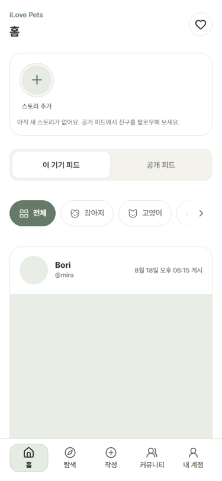</td>
    <td>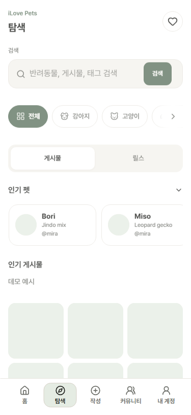</td>
    <td>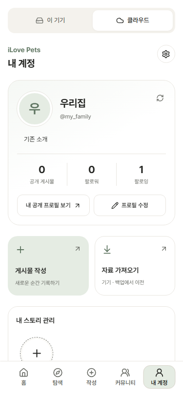</td>
  </tr>
  <tr><th>작성 · 사진 일기</th><th>커뮤니티 · 게시판</th><th>인증 · 로그인</th></tr>
  <tr>
    <td>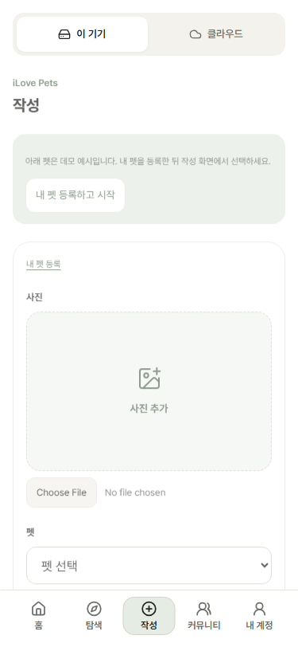</td>
    <td>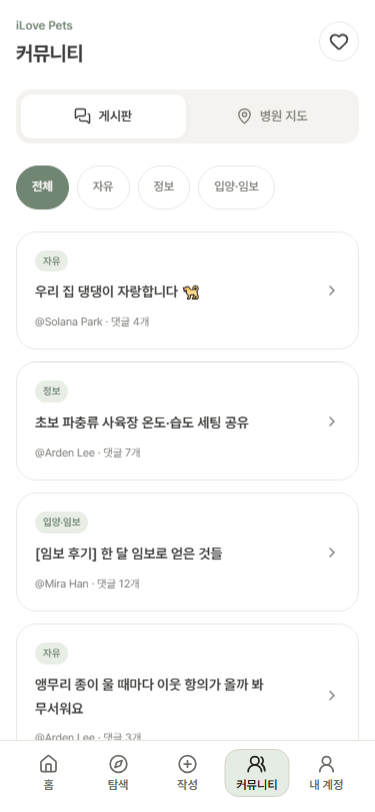</td>
    <td>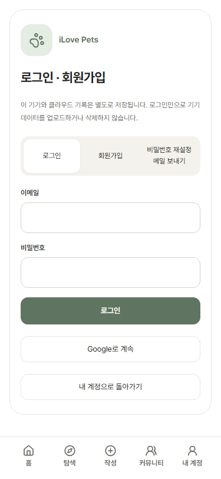</td>
  </tr>
</table>

<details>
<summary>성장 기록 · 활동 알림 · 자료 이전 · 다크 모드 보기</summary>

<table>
  <tr><th>성장·케어 기록</th><th>활동 알림</th><th>자료 이전 미리보기</th></tr>
  <tr>
    <td>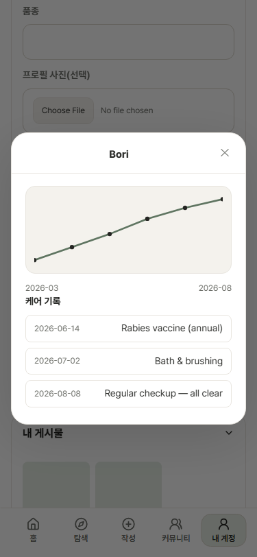</td>
    <td>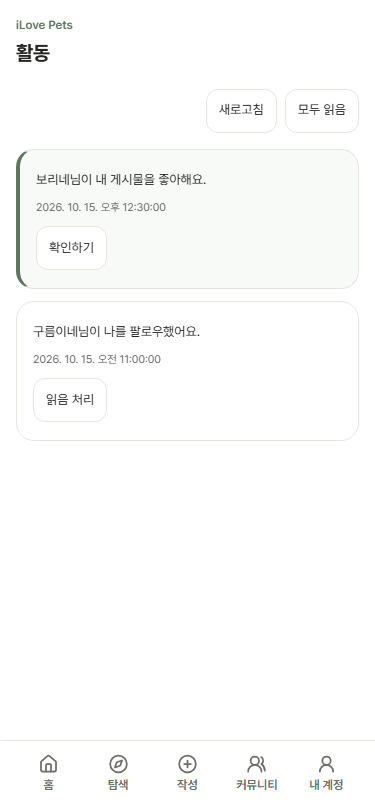</td>
    <td>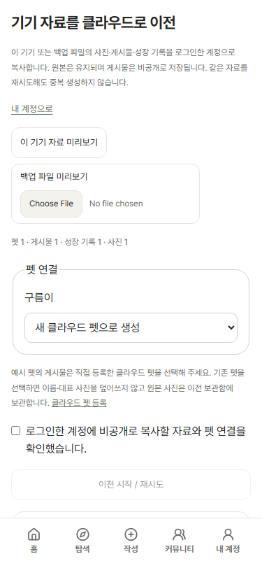</td>
  </tr>
  <tr><th>홈 · 다크</th><th>설정 · 다크</th><th>공개 프로필</th></tr>
  <tr>
    <td>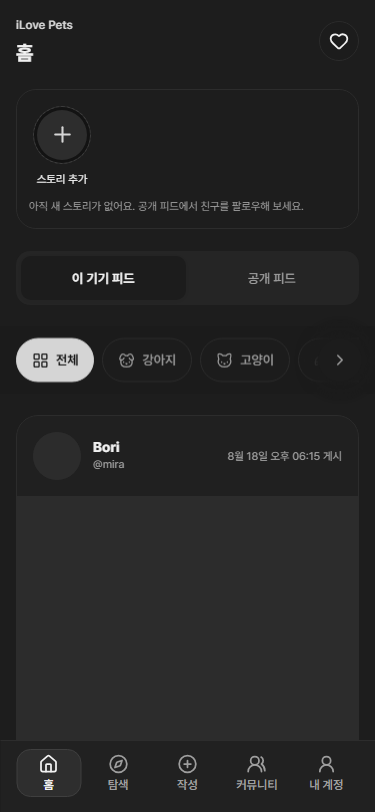</td>
    <td>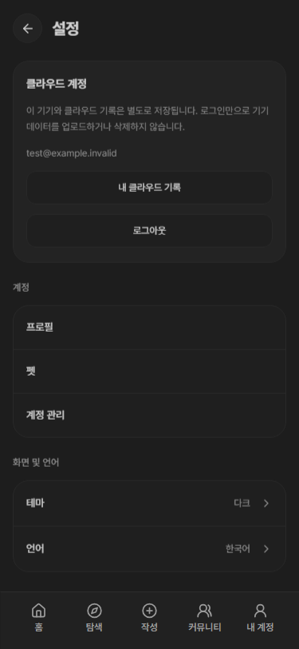</td>
    <td>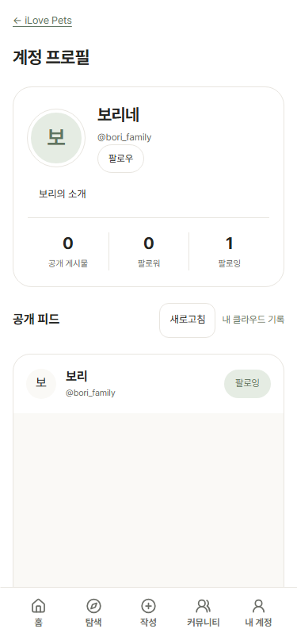</td>
  </tr>
</table>

</details>

## 처음 방문했다면

하단 메뉴는 **홈 / 탐색 / 작성 / 커뮤니티 / 내 계정**입니다. 활동 알림은 상단 하트 버튼에서, 설정은 내 계정에서 엽니다.

1. **둘러보기:** 로그인 없이 홈의 카테고리를 바꾸고 탐색·커뮤니티 화면을 살펴봅니다.
2. **내 기기에 기록하기:** 내 계정의 `이 기기`에서 펫을 등록하고 작성 화면에서 그 펫의 사진 일기를 저장합니다.
3. **계정으로 사용하기:** 로그인 후 `클라우드`에서 프로필과 펫을 등록합니다. 새 게시물은 비공개로 저장되며, 공유하려면 별도로 공개를 선택합니다.

Google OAuth가 테스트 모드인 동안에는 등록된 테스트 사용자만 로그인할 수 있습니다. 로그인할 수 없어도 로컬 기능과 데모 화면은 확인할 수 있습니다.

## 사용 시나리오

### 1. 반려동물의 일상을 내 기기에 기록하기

`내 계정 → 이 기기 → 펫 등록 → 작성 → 펫·사진·본문 선택 → 저장`

등록한 펫에 사진 일기를 남기고, 내 계정에서 펫별 게시물과 성장 기록을 관리합니다. 날짜·체중·메모를 추가해 캘린더와 그래프로 확인합니다. 샘플 펫과 직접 등록한 펫은 구분하며, 새 글은 직접 등록한 펫에 작성합니다.

기기 자료는 JSON 백업으로 내보낼 수 있습니다. 복원은 미리보기 후 **현재 기기 자료 전체를 교체**하므로 아래의 클라우드 복사와 다릅니다. 펫 삭제 전에는 연결된 게시물을 먼저 삭제해야 합니다.

### 2. 비공개 기록에서 공개 소통으로 확장하기

`Google 로그인 → 클라우드 펫 등록 → 사진 게시물 저장 → 공개 확인 → 공개 프로필·피드 노출`

새 클라우드 사진 게시물은 비공개입니다. 사용자가 공개로 전환한 글만 공개 피드와 프로필에 노출됩니다. 다른 계정은 프로필을 방문해 팔로우하고, 공개 글에 좋아요와 댓글을 남깁니다. 작성자는 활동 알림에서 반응을 확인하고 해당 글로 이동합니다.

공개 취소·삭제 후에는 새 공개 이미지 요청과 관련 알림 대상 접근도 다시 제한합니다. 계정 전용 기록과 이메일은 공개 프로필에 포함하지 않습니다.

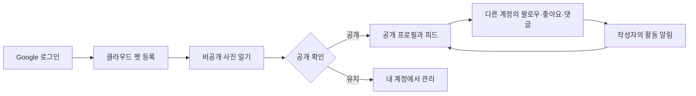

### 3. 팔로우한 이웃의 스토리 보기

`홈 상단 원형 목록 → 사용자 선택 → 사진 스토리 보기`

사진 스토리는 24시간 동안 유지됩니다. 내 스토리와 팔로우 관계에 따라 허용된 스토리를 볼 수 있으며, 자동 넘김·일시정지·스와이프·키보드 이동을 제공합니다. 만료·삭제·팔로우 해제 후에는 새 이미지 요청을 제한합니다. 동영상·음악·스티커·DM 기능은 포함하지 않습니다.

### 4. 기기 자료를 계정으로 옮기기

`내 계정 → 자료 가져오기 → 기기 또는 백업 미리보기 → 펫 연결 → 확인 → 비공개 복사`

1. 옮길 펫·게시물·성장 기록·사진 수를 확인합니다.
2. 자료의 펫을 새 클라우드 펫으로 만들거나 기존 펫에 연결합니다. 샘플 펫에 연결된 글은 실제 클라우드 펫을 직접 선택해야 합니다.
3. 확인 후 계정에 비공개로 복사합니다. **원본 기기 자료는 유지**하며 기존 클라우드 펫의 이름과 대표 사진을 덮어쓰지 않습니다.
4. 중단 시 같은 자료로 재시도할 수 있습니다. 이전 이력과 내용·사진 해시로 중복을 방지하고, 변경된 원본은 충돌로 안내합니다.

기기의 좋아요·댓글은 공개 반응으로 생성하지 않고 개인 보관 메모로 남깁니다. 원본 날짜·태그·댓글·펫 사진은 이전 보관함에서 확인합니다.

## 구현 범위

| 영역          | 현재 제공하는 기능                                                    | 범위와 제한                                                            |
| ------------- | --------------------------------------------------------------------- | ---------------------------------------------------------------------- |
| 인증          | Google OAuth, 세션 유지, 로그아웃, 이메일 가입·복구 UI                | Google 실제 로그인 확인. 이메일 발송·복구는 SMTP 설정과 실전 검증 필요 |
| 기기 기록     | 펫·게시물·성장 기록 관리, 사진, 백업·복원                             | 브라우저와 사이트 주소별로 분리                                        |
| 클라우드 기록 | 계정별 펫·성장 기록·비공개 사진 CRUD                                  | 소유자 권한 검사와 버전 충돌 처리                                      |
| 공개 소셜     | 프로필, 사용자 검색, 팔로우, 공개·팔로잉 피드, 좋아요·댓글, 공유 링크 | 공개로 선택한 글에 적용                                                |
| 스토리        | 사진 등록·조회, 팔로우 기반 접근, 24시간 만료                         | 사진 전용                                                              |
| 활동 알림     | 팔로우·좋아요·댓글, 미읽음 수, 개별·전체 읽음, 페이지 조회            | 화면 활성 시 45초 간격·포커스 복귀 시 갱신. 푸시 알림 아님             |
| 자료 이전     | 기기·백업 미리보기, 펫 연결, 비공개 복사, 중단 후 재시도              | 자동 병합하지 않음. 원본 유지                                          |
| 탐색·커뮤니티 | 인기 펫, 사진 그리드, 게시판·카테고리 UI                              | 인기·릴스·게시판 콘텐츠는 샘플. 실제 동영상·서버 게시판 서비스 아님    |
| 병원 지도     | Leaflet 지도, 지역·야간 필터, 전화 링크                               | 샘플 정보. 실제 진료·영업 확인 및 예약 기능 없음                       |
| 설정·PWA      | 시스템·라이트·다크, ko/en/ja, 앱 셸·로컬 자료 접근                    | 알림 설정은 기기/UI 설정. 오프라인 클라우드 쓰기는 미지원              |

약관·개인정보·소개 화면은 포트폴리오용 문구입니다. 계정 삭제·신고·차단과 운영 정책은 후속 과제입니다.

## 데이터는 어디에 저장되나요?

| 구분        | 저장 위치                                     | 다른 기기에서 보기 | 용도                         |
| ----------- | --------------------------------------------- | ------------------ | ---------------------------- |
| 샘플 콘텐츠 | 앱에 포함된 데모 데이터                       | 같은 샘플 표시     | 화면과 인터랙션 체험         |
| 이 기기     | localStorage 메타데이터 + IndexedDB 사진 Blob | 자동 공유 안 됨    | 로그인 없는 개인 기록        |
| 클라우드    | Supabase PostgreSQL + 비공개 Storage          | 같은 계정으로 접근 | 계정 전용 기록과 선택적 공개 |

`127.0.0.1`과 배포 사이트, 서로 다른 브라우저는 기기 저장 공간을 공유하지 않습니다. 브라우저 데이터 삭제 시 로컬 기록도 사라질 수 있으므로 백업을 권장합니다. 로그인만으로 기기 자료가 자동 업로드되지는 않습니다.

| 작업                   | 결과                                           |
| ---------------------- | ---------------------------------------------- |
| JSON 백업 복원         | 현재 기기 자료를 백업 내용으로 교체            |
| 클라우드 자료 가져오기 | 기기 원본을 유지하며 로그인 계정에 비공개 복사 |
| 게시물 공개 전환       | 해당 클라우드 글을 공개 소셜에 노출            |

사진은 JPEG·PNG·WebP, 원본 5 MiB 이하를 받습니다. 클라우드 예약 한도는 사용자 50 MiB·전체 800 MiB이며 동시 대기 예약 수를 제한합니다. 처리 실패·중단 사진은 실제 파일 정리가 끝날 때까지 용량에 포함될 수 있습니다. 백업 복원 한도는 파일 100 MiB·사진 합계 64 MiB이며, 복원에는 브라우저의 Web Locks 지원이 필요합니다.

## 로컬 실행

Node.js **20.19 이상**과 npm을 사용합니다.

```bash
npm ci
npm run dev -- --host 127.0.0.1
```

터미널에 표시된 주소를 엽니다. 기본 개발 포트는 `5173`입니다. 환경변수가 없으면 로컬·데모 모드로 실행되며 인증과 클라우드 기능은 비활성화됩니다.

### Supabase 연결

`.env.example`을 `.env.local`로 복사하고 본인 프로젝트의 공개 값을 입력합니다.

```dotenv
VITE_SUPABASE_URL=https://YOUR_PROJECT.supabase.co
VITE_SUPABASE_PUBLISHABLE_KEY=sb_publishable_YOUR_PUBLIC_KEY
```

`VITE_*`는 브라우저 번들에 포함됩니다. service-role·secret 키, OAuth Client Secret, SMTP 비밀번호는 여기에 넣거나 Git에 커밋하지 않습니다. 환경변수 수정 후 개발 서버를 다시 시작합니다.

새 Supabase 프로젝트는 다음 SQL 마이그레이션을 **순서대로 각각 한 번** 적용합니다.

1. [기본 스키마와 권한](supabase/migrations/202610140001_server_foundation.sql)
2. [비공개 기록과 사진 처리](supabase/migrations/202610150001_private_cloud.sql)
3. [버전 충돌 응답](supabase/migrations/202610150002_conflict_http_status.sql)
4. [소셜과 스토리](supabase/migrations/202610150003_social_stories.sql)
5. [프로필과 피드](supabase/migrations/202610150004_profiles_feeds.sql)
6. [활동 알림](supabase/migrations/202610150005_notifications.sql)
7. [기기 자료 이전](supabase/migrations/202610150006_local_import.sql)

Supabase Authentication의 Site URL은 배포 주소로 설정하고, Redirect URLs에는 사용하는 배포·개발 주소의 `/auth/callback`, `/auth/reset-password`를 등록합니다. Google 제공자에는 Google Cloud에서 발급한 OAuth 정보를 설정합니다. Google의 승인된 리디렉션 URI는 `https://YOUR_PROJECT.supabase.co/auth/v1/callback`입니다.

사진 기능에는 Edge 런타임 업로드와 두 함수 배포가 필요합니다.

```bash
npx supabase login
npm run publish:edge-runtime
npx supabase functions deploy cloud-media --project-ref YOUR_PROJECT_REF --use-api
npx supabase functions deploy social-media --project-ref YOUR_PROJECT_REF --use-api
```

위 방식에는 로컬 Docker가 필요하지 않습니다. 사용자 지정 도메인을 추가하면 Auth 리디렉션과 함수의 `APP_ORIGINS` 허용 출처도 맞춥니다. 상세 절차는 [클라우드 안내](MyAIAgent/ilove-pets-cloud-setup.md), [소셜·스토리 안내](MyAIAgent/ilove-pets-social-stories.md), [알림·이전 안내](MyAIAgent/ilove-pets-notifications-import.md)를 참고하세요. 해당 문서들은 개발 당시의 단계별 이력도 포함합니다.

### 빌드와 배포

```bash
npm run build
npm run preview
```

미리보기 주소는 `http://127.0.0.1:5174`입니다. Cloudflare Pages의 빌드 명령은 `npm run build`, 출력 디렉터리는 `dist`이며, 클라우드 연결에는 빌드 환경에도 위 공개 환경변수를 설정해야 합니다. 현재 사이트는 `main` 브랜치와 연결해 배포합니다.

## 구조와 설계

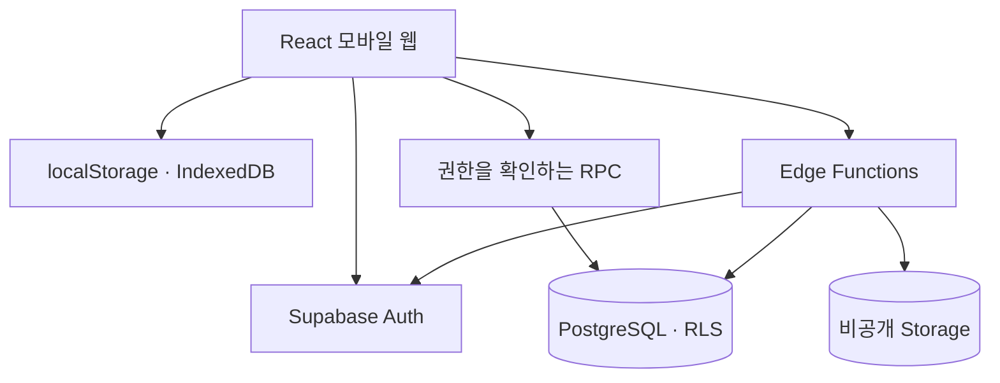

- **저장 범위 분리:** 로컬·클라우드를 명시적으로 선택하고 자료 이전은 별도 확인 흐름으로 제공합니다.
- **서버에서 권한 판단:** 소유 자료에 RLS를 적용하고 변경은 권한을 검사하는 RPC로 제한합니다. 공개 조회는 필요한 필드만 반환하며 프런트엔드에 관리자 키를 사용하지 않습니다.
- **사진 처리:** 용량 예약 → 브라우저 리사이즈 → 비공개 업로드 → 서버 실제 이미지 디코딩·메타데이터 제거·WebP 변환 → 기록 연결 순서입니다. 확장자나 MIME 선언만 신뢰하지 않습니다.
- **접근 재검사:** 공개 사진과 스토리도 버킷 전체를 공개하지 않고 `social-media` 함수가 요청별 접근 조건을 확인합니다.
- **충돌과 재시도:** 수정은 버전을 비교합니다. 자료 이전은 원본 식별자와 해시를 기록해 중복 생성과 삭제된 자료의 재생성을 막습니다.
- **캐시 경계:** 인증·클라우드 API를 서비스 워커 캐시에서 제외합니다. 오프라인 앱 셸과 로컬 접근을 계정 데이터 동기화와 구분합니다.

| 기술                                           | 역할                             |
| ---------------------------------------------- | -------------------------------- |
| React 19 · TypeScript 6 · React Router 7       | 화면·상태·라우팅                 |
| Vite 8                                         | 개발 서버와 production 빌드      |
| i18next · CSS · Lucide                         | 다국어, 테마·반응형 UI, 아이콘   |
| Leaflet                                        | 병원 지도 UI                     |
| Supabase JS · PostgreSQL · Storage             | 인증, 소유자별 데이터, 사진 저장 |
| Deno Edge Functions · ImageMagick WASM         | 사진 검증·변환과 접근 제어       |
| Vitest · Testing Library · Playwright · PGlite | 앱·브라우저·DB 계약 검사         |
| Cloudflare Pages                               | 정적 웹 배포                     |

### 주요 경로와 코드 위치

| URL                                                 | 화면                         |
| --------------------------------------------------- | ---------------------------- |
| `/` · `/explore` · `/create`                        | 홈·탐색·작성                 |
| `/community`                                        | 게시판·병원 지도             |
| `/myaccount` · `/settings`                          | 기기/클라우드 계정 관리·설정 |
| `/auth` · `/auth/callback` · `/auth/reset-password` | 로그인·인증 복귀·복구        |
| `/cloud` · `/myaccount/import`                      | 클라우드 기록·자료 이전      |
| `/users/:username` · `/posts/:postId`               | 공개 프로필·게시물 상세      |
| `/activity`                                         | 계정 활동 알림               |

```text
src/
  features/       # home, explore, create, my, auth, cloud, social, activity, import 등
  components/     # 공통 UI
  services/       # 저장·API 연동
  i18n/           # 한국어·영어·일본어
  styles/         # 페이지·공통 표면·반응형 스타일
supabase/
  migrations/     # 스키마·RLS·RPC
  functions/      # 사진 처리·접근 제어
tests/            # 브라우저 시나리오와 서버 검사
docs/screenshots/ # README 캡처와 출처
MyAIAgent/        # 설계·설정·진행·검증 기록
```

## 검증과 현재 한계

주요 검사 명령입니다. 브라우저 검사는 production 빌드를 대상으로 합니다.

```bash
npm run typecheck
npm run lint
npm run test:run
npm run test:server
npm run playwright:install
npm run smoke:preview
```

2026-10-15 UI 변경 기준 검증 기록:

| 구분         | 확인한 내용                                                                                                        |
| ------------ | ------------------------------------------------------------------------------------------------------------------ |
| 앱 단위 검사 | 38개 파일·192개 통과                                                                                               |
| 서버 검사    | 알림·자료 이전 단계까지 41개 통과. UI 변경과 별도 수행                                                             |
| Chromium     | 전체 70개 중 69개 통과 후 프로필 이동 대기 선택자를 보완하고 관련 19개 재검사 통과                                 |
| 추가 UI 검사 | 11개 화면 라이트·다크, ko/en/ja와 375·768·1280px 및 지도 너비를 5개 검사로 확인. 모의 API 사용                     |
| 실제 연동    | Google 로그인·세션 유지·사진 등록을 사용자 확인. 임시 계정 간 권한·공개 취소·알림·자료 이전은 원격 API로 별도 검증 |

이번 README 작업에서는 앱 코드를 변경하지 않고 추가 화면 캡처와 문서·이미지 참조를 확인했습니다. 상세 근거는 [UI 검증 기록](MyAIAgent/ilove-pets-ui-refresh.md), [프로필·피드 기록](MyAIAgent/ilove-pets-profiles-feeds.md), [알림·자료 이전 기록](MyAIAgent/ilove-pets-notifications-import.md)에 남겨 두었습니다.

남은 과제는 이메일 발송·복구 실전 검증, 실물 모바일에서 계정 간 전체 시나리오, 신고·차단·계정 삭제, 실제 커뮤니티 데이터 연결입니다. 초기 JS 번들 크기 개선과 Windows에서 발생한 기존 `dist` 파일 잠금 대응도 후속 작업입니다. 샘플 병원 데이터와 포트폴리오 정책 문구를 운영 서비스 정보로 간주하지 않습니다.

## 관련 문서

- [서버 설계](MyAIAgent/ilove-pets-server-design.md): 데이터와 권한 구조
- [프로필·피드](MyAIAgent/ilove-pets-profiles-feeds.md): 공개 범위와 소셜 흐름
- [알림·자료 이전](MyAIAgent/ilove-pets-notifications-import.md): 이벤트·중복 방지·복구
- [전체 UI 정리](MyAIAgent/ilove-pets-ui-refresh.md): 디자인 적용 범위와 검증
- [진행 보드](MyAIAgent/ilove-pets-progress-board.md): 단계별 개발 이력
- [캡처 목록·출처](docs/screenshots/README.md): 이미지별 화면 설명과 촬영 조건
